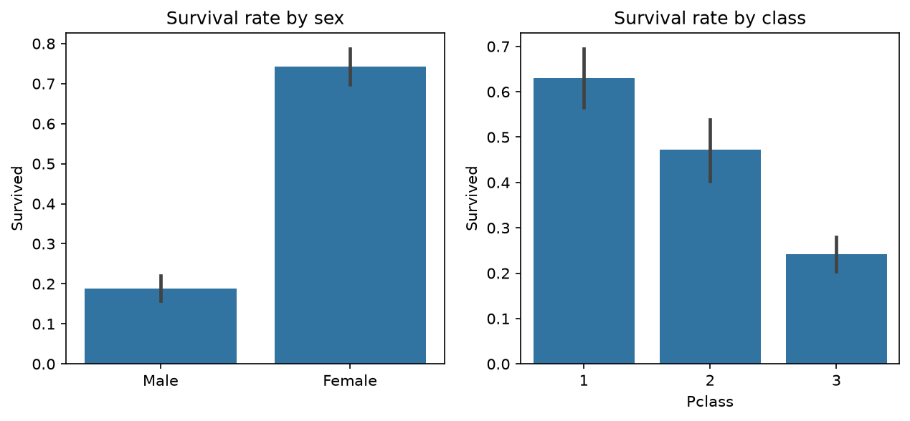
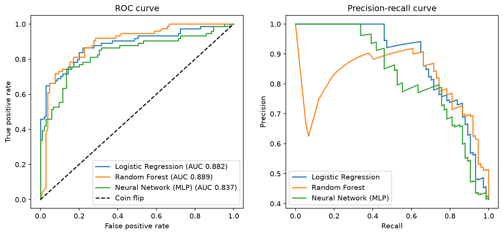
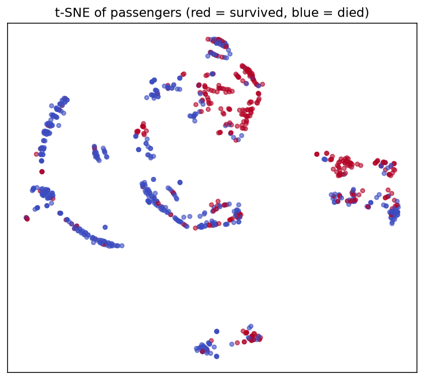
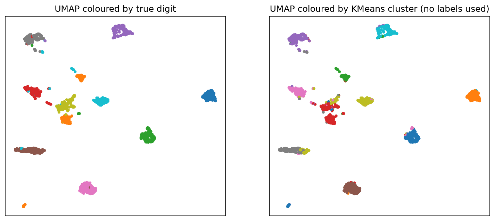
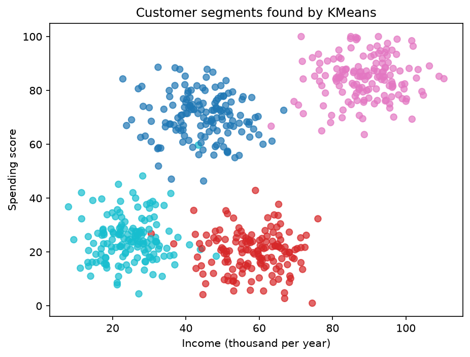

# Machine learning project: from raw data to a small app

An end-to-end ML project on three different problems: tabular data with a target (Titanic), image data (handwritten digits), and data with no target at all (customer segmentation).

**Author:** Rasmus Andersen

## Contents

| Part | Data | Type of problem | Scripts |
|---|---|---|---|
| 1. Titanic | 891 passengers (tabular) | Binary classification | `learning_steps/`, `prep.py`, `22_tuning.py` to `29_chi2.py` |
| 2. Digits | 1,797 images, 8x8 pixels | Multiclass classification | `15_` to `18_` |
| 3. Customers | 600 customers (synthetic) | No target: clustering, then classification | `19_` to `21_` |
| App | All parts | Interactive dashboard: survival predictor plus 5 pages of charts | `23_save_model.py`, `app.py`, `pages/` |

## What was done

**Data preparation (Titanic):** filled missing ages with the median and missing ports with the most common value, one-hot encoded the port, label-encoded sex, and dropped identifier and free-text columns. Cabin (77% missing) was dropped.

**EDA:** bar charts, histograms and a correlation matrix. Sex, class and age were the strongest patterns (for example, 97% of 1st-class women survived vs 14% of 3rd-class men).

**Statistics:** chi-square tests of independence between survival and sex (p = 1.2e-58), passenger class (p = 4.6e-23) and port of embarkation (p = 1.8e-06). All three are statistically significant, but significance is not proof of cause. The port effect partly overlaps with class (51% of Cherbourg passengers were 1st class vs 20% at Southampton), though class does not explain Queenstown, where 94% were 3rd class but survival was higher than at Southampton.

**Unsupervised learning:** PCA, t-SNE, UMAP and KMeans on both Titanic and the digits, plus clustering to create a target variable for the customer data.

**Supervised learning:** Logistic Regression, Random Forest, XGBoost, a neural network (scikit-learn MLP) and a CNN (Keras/TensorFlow) for the images.

**Evaluation:** confusion matrices, classification reports, ROC-AUC, precision-recall curves, 5-fold cross-validation, GridSearchCV and the Brier score.

**Dashboard (Streamlit):** a multi-page app with a survival predictor (warns when the input is unusual and rounds the result) and pages for data exploration, Titanic model evaluation, unsupervised learning, the digits models (including a classification report and ROC-AUC for the CNN) and customer segmentation. The pages have interactive controls, for example a checkbox that removes the port columns to show how the clusters change.

## Results

### Titanic (5-fold cross-validated ROC-AUC, all 891 passengers)

| Model | CV AUC |
|---|---|
| Logistic Regression | 0.849 |
| Random Forest | 0.858 |
| Neural network (MLP) | 0.844 |

All three models perform about the same. Random Forest was slightly ahead on average, but not in every fold.

### Titanic, tuning (Random Forest vs XGBoost, tuned with GridSearchCV on the training set)

| Model | CV AUC (training data) | Test AUC | Test accuracy |
|---|---|---|---|
| Random Forest | 0.862 | 0.902 | 84.9% |
| XGBoost | 0.860 | 0.883 | 79.3% |

The two models have practically the same CV AUC. The 5-point accuracy gap on the test set is 10 passengers out of 179 and should not be over-interpreted.

### Digits (same train/test split, 360 test images)

| Model | Accuracy |
|---|---|
| Random Forest on pixels | 96.39% |
| CNN | 97.50% |

The CNN got 4 more images right. Both models struggle most with the digit 8. UMAP followed by KMeans (without labels) reached an Adjusted Rand Index of 0.667 against the true digits.

### Customer segments (synthetic data)

KMeans found 4 segments that matched the generating groups closely. A Random Forest then learned to assign new customers to a segment with 98.3% accuracy (118 of 120). This number is high because the segments were created from the same columns, so it shows the boundaries are easy to learn, not that the segments are useful for a business.

## Figures

**Survival by sex and class**



**Model comparison on the Titanic test set**



**Passengers in 2D with t-SNE**



**Digits: UMAP with true labels vs KMeans clusters**



**Customer segments**



## What I learned

- **One train/test split can mislead.** On my first split, Logistic Regression and Random Forest both scored 81.0%. With cross-validation, Logistic Regression's accuracy was 78.9% and Random Forest's 81.5%, and Random Forest won in all 5 folds. Later, test AUCs came out higher than the CV scores, which suggests that split was easier than average.
- **Unsupervised results depend on how the data is prepared.** KMeans on Titanic first split passengers almost entirely by boarding port, because the 0/1 port columns dominated after scaling. Without those columns the clusters described passenger types (solo men, wealthy older passengers, large families) and the survival rates differed more (25% to 59%).
- **A neural network is not automatically better.** On the small Titanic table the MLP was not better than the simpler models. The CNN's gain on the digits was also small (97.5% vs 96.4%) on this tiny 8x8 dataset.
- **A good AUC does not mean trustworthy percentages.** My Random Forest ranks passengers well (AUC about 0.86), but its predicted chance for one specific passenger moved by up to 10 points when the ticket price changed by 20 pence. Larger leaves (`min_samples_leaf`) smoothed this on the one profile I tested, but lowered the overall score, so I kept a small value.
- **Models are unreliable outside their training data.** A 1st-class woman with a ticket price of 7.8 got about 80%, although the real rate for 1st-class women is 97%, because such a cheap 1st-class ticket is rare. The app now warns when the price is unusual for the class, and it rounds the result to the nearest 5%.

## Limitations

- The Titanic data is small (891 rows), so differences of 1 to 2 percentage points between models are within noise.
- The customer dataset is synthetic. Real customers are less cleanly separated.
- The digits are only 8x8 pixels. CNNs show much bigger advantages on larger images.
- No text or audio data was used.
- The Streamlit app runs locally only. It is not hosted online.

## Data sources

- Titanic: public CSV from the `datasciencedojo/datasets` repository on GitHub.
- Digits: `sklearn.datasets.load_digits` (built into scikit-learn).
- Customers: generated by `19_make_customers.py`.

## How to run

Requires Python 3 (developed on 3.13).

```bash
python -m venv venv
source venv/Scripts/activate
pip install -r requirements.txt
curl -o titanic.csv https://raw.githubusercontent.com/datasciencedojo/datasets/master/titanic.csv
```

Run any script from the project folder, for example `py 22_tuning.py` or `py learning_steps/11_model.py`.

To recreate the figures in `images/`, run `py 30_make_images.py`.

To start the app:

```bash
py 23_save_model.py
streamlit run app.py
```

The chart pages are in the sidebar. The Digits page trains the CNN the first time it opens, which takes up to a minute.

`19_make_customers.py` must be run before `20_segment.py`, and `20_segment.py` before `21_segment_classifier.py`.
